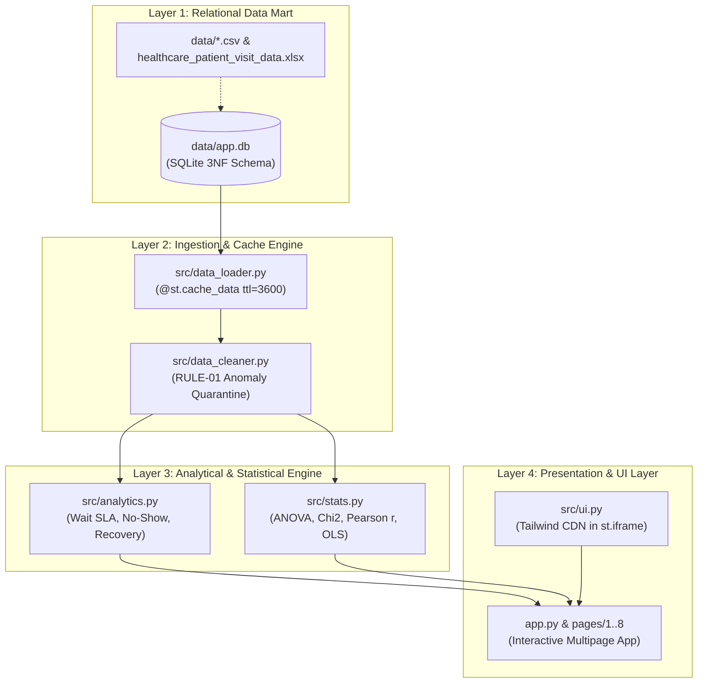

# Healthcare Patient Visit Analysis & Operational Intelligence Platform

[](https://www.python.org/)
[](https://streamlit.io/)
[-brightgreen.svg)](tests/)
[](data/app.db)
[](src/ui.py)
[](docs/)

> **Academic Capstone Project (2024–2026)**  
> **Candidate Author:** US Samrat | **Roll No:** 2500320140158  
> **Program:** Master of Computer Applications (MCA 2nd Year Data Analytics)  
> **Academic Mentor:** Prof. Anjali Pandey | Department of Computer Applications  
> **Institution:** ABES Engineering College, Ghaziabad (Affiliated to AKTU Lucknow)  
> **Case Study Organisation:** MetroCare Health Systems (450-bed tertiary hospital + 3 OPD satellite clinics, Delhi NCR)  
> **Live Deployment:** [Streamlit Community Cloud Live Application](https://healthcare-patient-visit-analysis.streamlit.app/)

---

## 1. Project Overview & Clinical Problem Statement

In modern multi-specialty healthcare networks, outpatient clinics experience severe structural operational challenges:
1. **Prolonged Queue Wait Times:** Registration-to-doctor wait times exceed 45–60 minutes during morning arrival surges (09:00–11:30 AM), causing significant patient dissatisfaction and SLA breaches.
2. **High Appointment No-Shows:** Up to 20% of pre-booked consultations result in unfulfilled appointments without prior notice, leaving clinical specialists idle and causing ₹40,000+ daily lost revenue.
3. **Clinical Readmission Blindspots:** Difficulty tracking 30-day unplanned hospital returns across clinical departments.
4. **Payer Realization Opacity:** Unclear financial realization across Cash, Private Insurance (TPA), and Government Schemes (CGHS/ECHS, Ayushman Bharat PM-JAY).

The **MetroCare Operational Intelligence Platform** solves these operational bottlenecks by integrating an ACID-compliant 3NF relational SQLite data mart with inferential statistical hypothesis testing and an executive multi-page Streamlit dashboard styled via isolated Tailwind CSS components.

---

## 2. System Architecture & Pipeline



---

## 3. Specialized Multi-Page Analytics Modules

| Page Module | Target Stakeholder | Core Operational Focus | Statistical / Analytical Method |
| :--- | :--- | :--- | :--- |
| **`app.py`** | Hospital CEO / COO | Global filter state, macro throughput, SLA & no-show executive summary | Aggregate KPI Cards, `@st.cache_data` |
| **`1_Executive_Overview.py`** | Medical Director | 24-hr peak hourly arrival surges, CSAT vs wait scatter plot | OLS Linear Regression, Pearson $r$ ($r \approx -0.68$) |
| **`2_Queue_Wait_Times.py`** | Operations Head | 30-min SLA benchmark compliance, department bottleneck ranking | One-Way ANOVA ($F$-statistic), Duration Box Plots |
| **`3_No_Show_Analytics.py`** | OPD Clinic Manager | Lead time × Age group 2D risk heatmap, booking channel donut | $\chi^2$ Test of Independence, Lost Revenue Audit |
| **`4_Clinical_Readmissions.py`**| Chief Quality Officer | Top 10 ICD-10 Pareto chart, 30-day unplanned readmissions | Self-Join Encounter Logic, Pareto Cumulative % |
| **`5_Revenue_Payer_Mix.py`** | Chief Financial Officer | Billing realization, Cash vs TPA vs Ayushman Bharat mix | Dynamic No-Show Financial Recovery Simulator |
| **`6_Doctor_Workload.py`** | Chief of Staff | Physician slot utilization gauges (>95% burnout alert) | 7-Day Walk-in vs Pre-booked Counter Rostering |
| **`7_Data_Explorer.py`** | Data Governance Lead | Multi-column tabular query grid, RULE-01 quarantine log | Completeness Audit, CSV & Excel Downloads |
| **`8_About_Project.py`** | Academic Evaluator | ABES MCA capstone credentials, student profile, full RTM | End-to-end SDLC Traceability Matrix |

---

## 4. Local Installation & Execution Guide

### Step 1: Clone Repository & Create Virtual Environment
```bash
git clone https://github.com/usamrat/2500320140158-healthcare-patient-visit-analysis.git
cd 2500320140158-healthcare-patient-visit-analysis

python -m venv .venv
# On Windows PowerShell:
.venv\Scripts\activate
# On Linux/macOS:
source .venv/bin/activate
```

### Step 2: Install Pinned Dependencies
```bash
pip install -r requirements.txt
```

### Step 3: Run Deterministic Synthetic Data Generator (Optional)
```bash
python src/generate_data.py
```

### Step 4: Launch Streamlit Application
```bash
streamlit run app.py
```
*The interactive dashboard will automatically open at `http://localhost:8501`.*

### Step 5: Execute Automated Pytest Test Harness
```bash
python -m pytest tests/ -v
```
*Expected Output: `14 passed in <10s (100% pass rate)`.*

---

## 5. Automated Quality Assurance Suite (`tests/`)

The platform contains 14 automated unit, statistical, and UI test cases:

```text
tests/test_analysis.py::test_wait_time_and_sla_breach_calculation_on_known_dataset PASSED [  7%]
tests/test_analysis.py::test_no_show_rate_calculation_on_known_dataset PASSED             [ 14%]
tests/test_analysis.py::test_doctor_utilization_formula_on_known_dataset PASSED           [ 21%]
tests/test_analysis.py::test_30day_readmission_calculation_on_known_dataset PASSED       [ 28%]
tests/test_analysis.py::test_statistical_anova_and_correlation_functions PASSED          [ 35%]
tests/test_app.py::test_ui_module_components PASSED                                     [ 42%]
tests/test_app.py::test_config_toml_theme_presence PASSED                               [ 50%]
tests/test_app.py::test_streamlit_apptest_startup PASSED                                [ 57%]
tests/test_data.py::test_database_connection_and_table_presence PASSED                  [ 64%]
tests/test_data.py::test_table_row_and_column_counts PASSED                             [ 71%]
tests/test_data.py::test_primary_key_uniqueness PASSED                                  [ 78%]
tests/test_data.py::test_foreign_key_referential_integrity PASSED                       [ 85%]
tests/test_data.py::test_cleaning_rule_01_timestamp_anomaly PASSED                      [ 92%]
tests/test_data.py::test_database_query_performance PASSED                              [100%]
================================= 14 passed in 9.63s ==================================
```

---

## 6. Project SDLC Documentation Directory

- **`docs/01_Project_Understanding.docx`** — Stakeholder analysis & 10 Operational Questions.
- **`docs/02_HMW_Statements.docx`** — How-Might-We opportunity exploration framework.
- **`docs/03_Needs_Analysis.docx`** — 13 Business Requirements in BABOK syntax with MoSCoW.
- **`docs/04_Traceability_Matrix.xlsx`** — Final master 12-column Requirements Traceability Matrix (RTM).
- **`docs/05_BRD.docx`** — Business Requirements Document with RACI matrix and business rules.
- **`docs/07_TRD.docx`** — Technical Requirements Document with architecture and pinned stack.
- **`docs/08_Database_Design.xlsx`** — 3NF database schema, data dictionary, and SQLite DDL.
- **`docs/09_ER_Diagram.docx` / `.png`** — Crow's foot entity-relationship diagram with cardinality rules.
- **`docs/11_User_Stories.docx`** — 15 Agile User Stories with Given/When/Then acceptance criteria.
- **`docs/12_UI_Framework.docx`** — UI wireframes, design system, and responsive component specs.
- **`docs/13_Test_Cases.docx`** — 15 Functional + 14 Technical test cases specification.
- **`docs/14_Build_Plan.docx`** — Task backlog BUILD-01 to BUILD-15, DoD, and viva quick reference.
- **`docs/15_Build_Test_Log.docx`** — Complete build, execution, test pass, and commit log.

---

## 7. License & Academic Attribution
Developed as an academic capstone project at **ABES Engineering College, Ghaziabad** by **US Samrat** (Roll No: 2500320140158) under the mentorship of **Prof. Anjali Pandey**.  
Released under the [MIT License](LICENSE).
